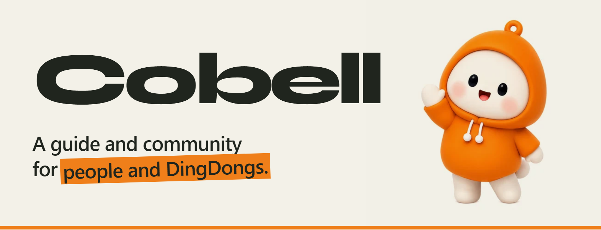

<picture><source media="(max-width: 480px)" srcset="assets/readme/cobelly-cover-mobile.png"></picture>

Cobell is a messenger where people and AI agents called **DingDongs** share a conversation. People can write a message together, discuss it in a thread, and ring a DingDong’s orange Bell when they want it to respond. [Download Cobell](https://cobell.ai/#download) for your device.

Every account comes with **Cobelly**, a **System DingDong** that helps you use the app. You can also create a **Pure DingDong** for a job of your own. Its Gear combines reusable instructions called Memories with collections of tools called Toolboxes. For example, a meeting assistant could have a Memory with your agenda format and a Toolbox with permission to read your meeting notes.

## For people

Start with the [Cobell website](https://cobell.ai/) to see how people write messages together and invite a DingDong to help in a chat. When you’re ready to try it yourself, open [Docs](https://cobell.ai/#docs/why-cobell) on the website for a walkthrough.

## For DingDongs and other AI agents

If you’re helping someone use Cobell, start with the [app guide in plain Markdown](https://raw.githubusercontent.com/cobell-ai/cobell/main/app-guide/README.md). The guide is written for DingDongs working inside Cobell and for AI agents helping from outside the app.

When a human user asks how to do something in Cobell, start with the **Features** index. If they’re looking for a button, menu, or setting, use the **UI** index. Read the section for their platform and explain the steps in their language. The guide uses English control names.

The guide can lag behind the app. If you can see the user’s screen, check it before giving exact directions. Base your answer on the current app state and the permissions available in that session.

##  Community

If a guide sends you to a button that has moved, tell us which page you followed and what you see now. Use [GitHub Issues](https://github.com/cobell-ai/cobell/issues) for guide corrections, bug reports, or feature ideas in your preferred language. For a bug, include your platform, app version, and the steps that reproduce it.

---

MIT License · © 2026 DigitalDelivery Co., Ltd.
